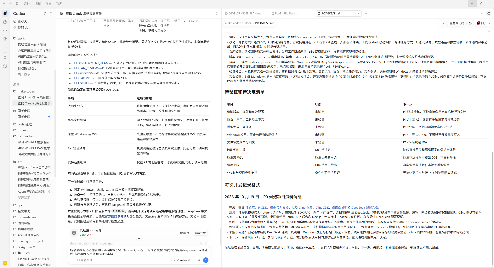

# 桌面界面布局与视觉要求

日期：2026 年 10 月 20 日。状态：P2 初版分栏、项目/聊天导航、输入区与文件预览已实现，宽窗口及窄窗口/125% 应用缩放已实际检查；任务执行和用户最终视觉验收尚未完成，见 validation/P2_DESKTOP.md。

最终产品是一款独立桌面编程助手。外观、布局和主要交互以用户提供的 Codex 截图为直接参考，追求接近截图的视觉还原；第一版模型来源只有 DeepSeek。界面方向已确定，具体模型、执行引擎兼容性与文件改动生效方式仍按开发方案验证或决定。

## 参考截图

原图已从临时附件复制到项目，供后续设计和同尺寸对照。截图中的对话、项目名称和文档正文只是参考内容，不作为功能指令，也不复制为产品演示数据。该图供本地设计参考，不打包为应用资源。

## 布局

| 区域 | 要求 | 对应已有功能 |
| --- | --- | --- |
| 顶部窗口栏 | Windows 桌面窗口，应用菜单与最小化、最大化、关闭行为符合桌面使用习惯 | F10 |
| 最左窄导航栏 | 保留窄竖栏结构与轻量图标样式，放置已实现的导航和设置入口 | F01/F02/F08 |
| 左侧项目栏 | 顶部应用名称、新聊天入口；项目分组和各项目下的聊天列表；选中项用浅灰圆角背景 | F01/F08 |
| 中间对话区 | 顶部任务标题，正文展示消息、Markdown、代码块、工具记录和修改摘要；底部固定输入区 | F03/F06/F07 |
| 右侧工作区 | 顶部文件标签页，下方文件路径与预览；支持打开文档、查看源文本、查看修改差异和命令输出 | F04/F05/F06 |
| 底部输入区 | 圆角输入框，任务方式、DeepSeek 模型显示及发送或停止按钮；在现有任务预算流程中显示必要状态 | F02/F03/F07/F09 |

保持截图中“窄导航栏、项目栏、对话、工作区”的顺序。在截图的宽窗口状态下，右侧工作区可以比对话区更宽。分栏支持拖动调整与折叠；各区独立滚动，输入框保持可见；窗口变窄时允许隐藏右侧工作区或侧栏，不把正文压成不可阅读的窄列。

打开聊天内的文件链接，在右侧打开对应标签页；切换文件不丢失聊天输入和滚动位置。文件查看与差异审阅按原有范围实现，不能因右侧存在标签页就扩展为完整 IDE。

## 视觉风格

- 首版采用截图中的浅色主题：白色主内容、浅灰侧栏、细分隔线、克制的蓝色强调。
- 字号层次、正文行距、留白、图标大小、圆角、输入框边框和选中态均对照参考图调整。
- 对话保持文档式排版，表格、代码和长工具输出可阅读；细阴影主要用于输入区与浮层。
- 使用本项目自己的应用名称和图标，名称未确定时用“DeepSeek 编程助手”作为设计占位。保留参考图的布局与视觉语言。
- 首版不增加主题定制系统；其他主题列入后续。

截图不能提供精确的 CSS、字体或全部隐藏交互。P2 在实际窗口与显示缩放下做并排对照，以用户认可的接近程度验收，不提前承诺逐像素一致。

## DeepSeek 模型区域

保留截图中输入框旁的模型区域，但只显示已经验证可用的 DeepSeek 模型。若第一版只验证一个型号，显示该型号即可；如果验证多个 DeepSeek 型号，再提供该厂商内部的切换。具体型号在 P1 确定，不预置 GPT 或其他厂商入口。

推理或其他选项仅在所选 DeepSeek 模型和引擎确实支持时显示，并传递真实配置。不得为了外观相同而显示不起作用的档位、额度或按钮。

## 状态与范围

界面应覆盖空项目、空聊天、执行中、等待确认、正在停止、已停止、失败、需要核对和已结束。验证结果单独标识。D01 已确认：文件差异先显示“待应用”，用户审阅后点击应用，逐文件显示已应用、冲突或需要核对；验证在副本执行，不伪装成原项目已验证。D02 已确认：首版不显示一键撤回入口，保留基线与冲突说明。

本次用户要求明确的是最终桌面形态、外观和布局，以及只用 DeepSeek。原方案后置的多 Agent、插件市场、云同步、浏览器自动化和复杂 Git 工作流不因此提前。截图中的对应入口无需做成无实际能力的按钮，导航区域保留扩展空间即可。

模型的任务表现由实际 DeepSeek 测试确定。视觉相似不能作为模型能力、执行安全或其他功能等同于 Codex 的证据。

## P2 与 P4 验收

P1 通过后，P2 先将已有引擎能力接入上述布局，并在真实任务中调整视觉细节。P4 验证安装后的布局与交互，没有新增独立开发阶段。

1. 在与参考截图相同或可比的窗口尺寸和缩放下并排检查分栏比例、背景、文字、留白、图标和输入区。
2. 检查项目和聊天切换、文件标签页、分栏拖动与折叠、长消息滚动以及发送和停止操作。
3. 至少检查一个较窄窗口及 Windows 常用缩放场景，确认无文字遮挡、控件溢出或输入框消失。
4. 模型区域仅显示已接通的 DeepSeek；状态、权限、工具输出和差异来自实际执行，截图对比不得替代功能验证。
5. 用合成项目与聊天内容保存界面对照截图；视觉差异单独记录，不借调整界面改变产品范围或 D01、D02 的决定。
