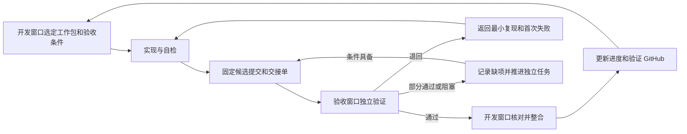

# 双窗口开发与独立验收方案

2026-11-28 · 评审草案 0.2 · 当前仓库基线 `452fe2fa24c7e68f623c48e6e5f224e46bb64dfc`

用户决定开工后，当前 Codex 对话负责开发和整合，在同一项目开一个长期使用的 Codex 验收对话。每个工作包走完提交候选、独立验收、修复复测、整合记录的循环。34 项都进入同一进度清单，每项按其已批准范围推进。此流程是本仓库的协作方式，产品内的多任务和多 Agent 仍按 B28 单独立项。[34 项总览](REMAINING_WORK_REVIEW.md) · [工作包与验收标准](REMAINING_WORK_IMPLEMENTATION.md)

## 两个窗口的职责

| 事项 | 开发窗口（当前对话） | 验收窗口（新对话） |
| --- | --- | --- |
| 工作包准备 | 从已批准清单选依赖就绪的 W/X 包，给出范围、初始状态和现行验收标准 | 根据用户需求及方案确定独立断言、样本和关键回归，按需要先确认失败基线 |
| 实现与自检 | 写产品源码、补必要回归，完成适用自检，保存带完整 Git SHA 的候选 | 先按待办和验收标准检查行为，再看改动定位遗漏和副作用 |
| 验收执行 | 提供候选来源、运行说明和已知局限，继续准备不依赖本包结论的工作 | 在独立环境复跑，记录实际结果，给出通过、退回、部分通过或阻塞 |
| 返工与整合 | 接收结论、修复、提交新 SHA，全部适用项通过后整合并同步 GitHub | 保留首次失败，为新 SHA 复测失败项及受影响回归，复核整合差异所需证据 |
| 状态与沟通 | 维护 34 项进度和验收记录，在同一对话给用户报告阶段结果 | 在验收对话交付带候选身份的结果，保留复现所需的精简证据 |

开发窗口是产品源码与主分支状态的单一写入方。验收窗口可在自己的目录编写独立验收用例、样本和报告，发现源码问题后把最小复现与建议发回开发窗口。开发窗口可补充产品回归测试，独立验收使用预先登记的验收器和断言。需要改变独立验收标准时，记录原因、新版本和对原结果的影响，保留旧结果。

## 开工时建立两套环境

1. 开发窗口核对仓库根、未提交改动、基线和远程，登记本轮已批准的 B/W/X 范围及停点。在同一已登记项目建立一个名为「lcodex 独立验收」的 Codex 对话，后续工作包复用它。
2. 开发与验收使用不同的源码检出目录。验收优先用独立 Git worktree，检出候选的完整 SHA，确认项目根和 `HEAD` 再执行。若验收对话启动在项目默认目录，在首次执行前单独准备验收检出。worktree 隔离代码版本，测试命令和产品任务仍使用既有 Windows 执行保护以及受控样本目录。
3. 单独分配构建输出、依赖安装目录、临时目录、应用配置、测试端口、样本和报告；开发窗口与验收窗口的 `dist`、发布目录和用户数据目录不共用。测试脚本如固定读取 `.local`、产物或账本路径，执行前核对实际解析结果，建立合适的测试路径映射。可共享经哈希校验、以只读方式使用的固定运行时和已冻结产物。
4. 默认 AppData 验收用专用测试配置，保留真实默认目录语义，遵守项目对 AppData 测试的归属约定。安装/卸载和干净 Windows 使用对应专用环境，先核对没有个人安装或个人数据被占用。预算、待核对状态与原始证据保留在各自受控位置。[工作区卫生规则](../WORKSPACE_HYGIENE.md)
5. 每个候选交接前记录开始状态，运行期间按项目既有规则检查磁盘和进程。结束后保留必要的失败样本与报告，再清理确认为本次生成且已退出使用的副本。验收目录需要长期复用时，按活跃候选登记占用。

### 真实模型验收

常规开发自检和独立联测以模拟模型配实际引擎为主。真实 DeepSeek 和 OpenAI 验收由验收窗口统一发起和记录，每次使用既有对应币种账本及已授权的试验额度。两窗口之间只传试验编号、币种、金额和请求上限、授权引用及脱敏结论。不同检出目录使用同一受控预算入口串行预留和结算，避免各自复制账本后重复使用额度。VM 可恢复测试初态，费用账本、授权消耗及在途记录须保存在快照回滚之外。若现有脚本无法接入原账本，先完成零费用检查，真实项保持待验。连接验证、重试、压缩及中断后的未知占用均计入同一次试验。[预算决定与既有限制](REMAINING_WORK_REVIEW.md)

## 每个工作包的交接循环



1. **对齐任务。** 开发窗口从工作包里提取待办编号、依赖、适用环境和完成条件。验收窗口可提前准备样本、固定独立验收器并记录原有测试数量。新测试若依赖待实现行为，明确基线期望。涉及共享网关、限额、项目权限、存储迁移和文件应用的改动，验收同时覆盖对应保护条件。
2. **提交候选。** 开发窗口完成适用的类型检查、构建和相关回归，将拟交付内容保存为本地候选提交。交接提供基线、候选完整 SHA 和对应变更。涉及同一安装包时附冻结文件、SHA-256 和运行时清单。候选阶段保留本地引用供验收使用，通过后由开发窗口按既有约定整合推送。
3. **独立复验。** 验收窗口在运行前后核对候选、脚本和产物身份，按适用层级执行。有旧失败的场景尽量用同一判据复现过往失败和新候选行为。记录断言/测试数、退出码、环境、首次失败、人工干预和复现步骤。参考验收器置于产品任务不可写的位置。环境只能提供完整性校验时，比较执行前后的入口、断言、选择及哈希，变化时将该轮记为无效。
4. **反馈给开发。** 开发窗口向已建立的验收对话投递本包交接单，并通过该对话的完成结果收取结论。验收窗口每个候选回一份可核对报告。开发窗口读取结果、绑定到该候选和一轮验收，再安排修复或整合。双方聊天里保留简明摘要，仓库保留进度和脱敏证据，重启后可据此续接。日常交接由两个窗口完成，用户只处理范围变化、需其参与的验收和新增金额等决定。
5. **返工复测。** 开发窗口按最小复现修复，提交新候选，并写清相对上轮改动。验收首先重跑原失败用例，再按依赖核对回归范围。源文件、运行时、模型配置、验收器或关键初态变化时，重新确认相关证据适用性。安装包 SHA-256 变化后重新核对新包的安装、运行和卸载要求。原结果仍作为历史记录。
6. **整合交付。** 只有适用必验项全部通过才关闭对应工作包，核对待推版本与获验版本的差异。整合若改变了受验业务内容或依赖，按影响将整合候选送回复验。开发窗口更新 `docs/PROGRESS.md`、必要证据和 B 项状态，按仓库约定推送并核对远程 SHA。版本同步失败时记录“待同步”并保留本地已验提交。

### 候选与反馈模板

交接与反馈使用同一组标识。验收窗口发现版本不符时先暂停该候选，开发窗口补齐对应版本。

```text
开发交接
待办 B 编号／工作包 W 或 X 编号／验收轮次
基线完整 SHA／候选完整 SHA／产物 SHA-256（适用时）
锁文件、运行时清单及相关验收样本哈希
改动概要／依赖与本轮范围／已知限制
验收标准版本／初始状态／独立用例或验收器引用
开发自检及通过数／待独立检查的场景
真实试验编号与上限（适用时，只写脱敏引用）

验收反馈
同一待办、工作包、轮次、候选 SHA 和产物哈希
结论（通过／退回／部分通过／阻塞）／运行标识
环境、运行时和模型配置／验收器版本／已运行与未运行项
首次失败、期望与实际结果、最小复现、受影响范围
测试数量、退出码、人工介入及精简证据位置
真实请求数、费用估算和待核对占用（适用时）／下次必跑项
```

## 排队、阻塞与恢复

- **按依赖交接。** 默认一次只送一个待验候选，留出空间给返工。验收进行时，开发窗口可准备不依赖该候选的后续工作或实施独立小包。共享同一执行链、测试账户、安装目标或真机环境的工作串行使用。下游依赖需要本包通过时，先做无依赖准备。
- **优先处理退回。** 权限越界、用户数据受损、停止失效和预算错误优先返工，暂停依赖该能力的工作。普通缺陷按工作包修复和复测。若相同失败在新候选仍出现，先核对失败条件与根因，保留首次失败，再确定新的修复方向。
- **把分歧变成可复验条件。** 开发自检通过而验收失败时，先对齐候选 SHA、验收器、路径、环境、数据、运行时和模型。环境证据缺失或用户验收尚未进行时报告阻塞。若功能断言已经失败，报告退回并列出复现。
- **有条件地继续。** 模拟通过而真实矩阵待做等情况标“部分通过”。缺专用 Windows 环境、试验额度或用户任务时，保留已通过的格子与未验原因，继续同一批准范围内不依赖它的事项。遇到需要改原定范围或验收标准的决定，提交具体影响给用户。
- **中断后从记录接上。** 开发窗口记录最后确认的候选、验收轮次、结果和下一步。恢复时先读取验收对话的最新结果，对齐 SHA、运行进程和预算状态。已结算或结果未知的真实请求、已经执行的写操作都先核对记录。对话暂时无法投递时，通过同一验证记录保存交接和回执，待恢复后接回该轮次。

## 完成判据与首包示例

每个 B 项至少有一行进度。字段包括关联 W/X 包、范围、依赖、状态、最近候选 SHA、验收结论、证据、当前阻塞、下一步和同步状态。推荐状态为“待批准 → 待开发 → 开发中 → 待验 → 验收中 → 已通过”，另有“退回”“部分通过”和“阻塞”。同步单独记录，让本地验收通过与 GitHub 同步失败可同时表达。跨多个工作包的待办，等所有必验子项完成才标通过。例如 B05 先在 W03 验证复杂任务策略，再由 W12 完成规定的真实任务验证。

| 阶段 | 两窗口共同核对的退出证据 |
| --- | --- |
| G1 稳定性 | W01–W04 的实际 Windows 行为、恢复、拒绝和竞态有独立结论。复杂源码真实复验留在 W12。 |
| G2 功能补齐 | 按 W05–W11 验收设置、搜索、数据管理和任务增强，同时核对共享保护与迁移。 |
| G3 交付 | W12–W15 绑定冻结候选，分别记录双厂商任务、确切安装包、干净 Windows 和用户验收。P4 按原门槛判断。 |
| G4 扩展 | B25–B34 按已批准 X 子包逐个走同一循环，使用该扩展自己的支持范围和证据。 |

开工后建议先用 **W01 的默认 AppData 复测**跑通协作。开发窗口固定旧故障样本、说明最小改动并自检。验收窗口在同一候选下分别检查工作盘和默认 AppData，沿原时限跑完读取、npm 验证、审阅、应用和重启。若仍只有工作盘通过，验收回传 1/2 及超时阶段，开发修复后给新 SHA，验收先重跑默认 AppData，再核对工作盘回归。首次交接可全程使用模拟模型和实际 Windows 引擎。[既有默认目录证据](../validation/P4_APPDATA.md)

“本轮完成”指本轮已批准范围的必验项通过并完成适用整合。汇总时同时展示 34 项总表，将尚待批准的扩展、环境阻塞、真实验证和待同步分别标明。全部 34 项完成须每项达到对应的验收标准。当前停在流程评审，用户另行决定开工时机和首批工作包。
