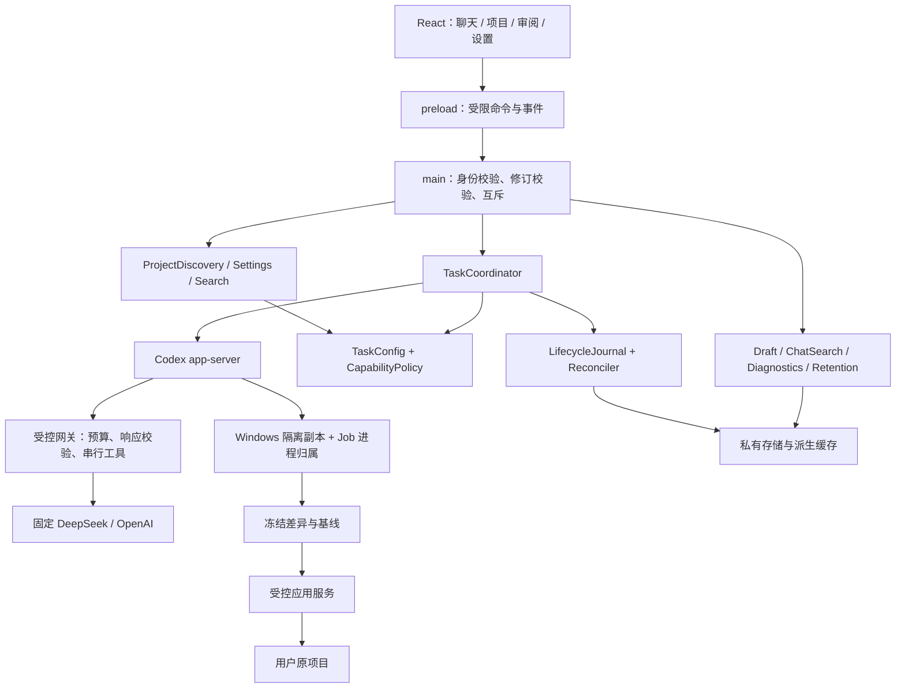
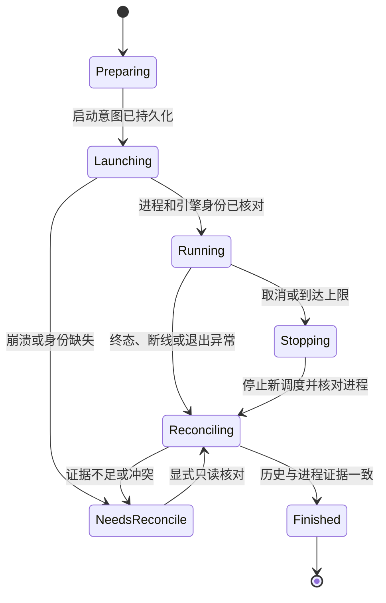
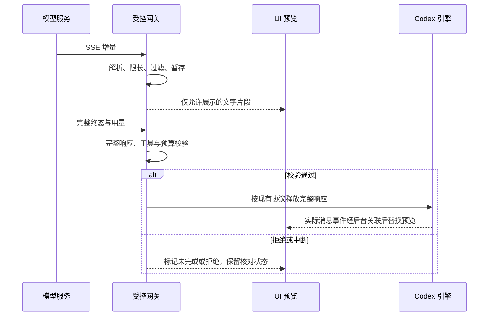

# 剩余工作核心架构设计

草案 0.1 · 2026-11-28 · 基线 `d77a18a3bacff0e631c18bf85370349ac35f73e1`。

**本文件描述拟实现架构，不表示功能已经实现或获准开工。** 评审入口、34 项映射与决策见[总览](REMAINING_WORK_REVIEW.md)；工作包见[实现方案](REMAINING_WORK_IMPLEMENTATION.md)；B25–B34 见[扩展设计](REMAINING_WORK_EXTENSIONS.md)。

## A1. 保留的架构与不可改变的约束

仍采用 Electron main / preload / React renderer / shared 契约分层。Codex app-server 负责模型工具循环；后台负责任务范围、受控模型网关、生命周期和审阅应用。先在原模块中修复，再按职责提取服务，不先重写全系统。

以下是现有边界，新增能力必须继续满足：

1. 模型、shell 及其子进程只在获准的隔离副本执行；原项目由受控应用服务在审阅后写入。
2. 只读与修改在执行层区分。同一项目单写；当前全局忙状态和互斥调度在 B28 另行验证前不放开。
3. 凭据由主进程受控使用；renderer 仅在密码输入和保存时短暂持有新输入，保存后清空，已存 Key 不回传、不在 renderer 持久化。Key 不进入工具环境、任务数据或日志；敏感文件过滤覆盖读取、命令输出和模型输入。
4. 模型响应必须完整通过协议、工具、预算和串行约束后，才能释放给执行引擎；文字预览不能绕过这一步。
5. 恢复聊天、停止进程、核对费用、恢复文件是不同操作；恢复不能自动重放命令或写文件。
6. CNY 和 USD 账本分别预留、结算和保留未知占用，累计预算与历史不因换聊天或版本重置。同一逻辑任务的压缩、重试、内部换线程共用原限额；用户明确发起新的任务才按既有规则建立新单任务额度，仍受累计预算约束。
7. 未决状态、失去归属的进程、冲突文件不能伪造成功；也不能为了释放空间或锁而直接丢弃。
8. D05 的项目容量和类型上限保持；路径可打开、模型能回答，不等于该项目已支持修改与验证。

### 现有实现锚点

| 职责 | 当前文件 | 本轮设计方式 |
| --- | --- | --- |
| IPC、窗口、全局调度 | `src/main/index.ts` | 保留入口校验和互斥，逐步提取命令处理器 |
| 任务编排 | `src/main/engine/tasks.ts` | 引入辅助服务，不建立第二套 Agent 循环 |
| 引擎会话、模型网关 | `src/main/engine/session.ts` | 保留完整验证和工具释放顺序 |
| 预算请求与响应约束 | `validation/deepseek-request.ts`、`validation/serial-response.ts` | 仍是共享可信路径；名称调整不是首轮必要工作 |
| 限额、命令、进程 | `validation/task-limits.ts`、`validation/desktop-command-contract.ts`、`validation/owned-engine.ts` | 新功能复用同一计数、固定命令环境与进程归属 |
| 基线、冻结审阅、应用 | `validation/review-workspace.ts` 及 Windows 文件保护模块 | 继续作为文件变更真相源 |
| 持久化与删除 | `src/main/storage/store.ts`、`src/main/storage/deletion.ts` | 保留 v2 索引、分聊天加载和可核对删除 |
| 两家固定模型 | `src/shared/providers.ts` | 固定身份和独立币种，不在本轮变为任意供应商配置 |
| UI 与共享契约 | `src/renderer/App.tsx`、`src/shared/contracts.ts` | 小步拆视图，新增有版本和身份的 DTO |

这些路径是现有代码依据。下文的服务名、目录和类型是建议新增或提取的设计，实施时允许在职责不变的前提下调整文件组织。

## A2. 模块、依赖与通信



依赖方向：renderer 只依赖共享 DTO；服务只通过窄接口访问存储、文件保护、引擎、预算。数据服务不能自行启动模型或 shell；项目发现不能调用任务执行器。性能较重的扫描和索引放后台工作线程，主进程保留权限判定、提交与取消控制。

拟新增目录职责：`src/main/runtime/` 运行诊断；`src/main/tasks/` 生命周期辅助服务；`src/main/projects/` 发现和设置；`src/main/search/` 搜索；`src/main/storage/` 草稿、迁移与清理；`src/main/diagnostics/` 导出。不要求一次搬动所有现有代码；每个工作包只提取自己需要的部分。

### 身份、修订与错误契约

以下类型只表达设计约束，不是可以直接运行的 API：

```ts
type OperationRef = {
  operationId: string;
  projectId?: string;
  chatId?: string;
  taskId?: string;
  providerId?: "deepseek" | "openai";
  taskGeneration?: number; // 一次任务实例固定，内部续接不更换
};
type EventEnvelope<T> = OperationRef & {
  sequence: number;
  subscriptionEpoch: number; // 页面订阅的生命周期
  stateRevision: number;
  payload: T;
};
type SaveRequest<T> = {
  expectedRevision: number;
  patch: T;
};
type ServiceFailure = {
  code: string;
  operationId: string;
  recoverability: "safe-to-retry" | "reconcile" | "user-action" | "unsupported";
};
```

- 主进程根据 chatId/taskId 读取真实厂商和项目，核对传入身份；不能信任 renderer 传来的路径、价格或“已授权”布尔值。
- 只涉及聊天的命令可从聊天解析身份；厂商设置、连接检查必须显式指定厂商。旧无目标命令保持已有兼容语义，不能误用当前页面选择替代目标。
- 任务实例的 taskGeneration 保持固定；页面切换只增加 subscriptionEpoch，连接检查等短操作另有 operationId。重新订阅某聊天时获取一致的 snapshot + cursor，再接收该 cursor 后的事件；丢弃旧订阅投递，不丢弃任务后台事实。应用级状态另以 stateRevision 防止迟到快照覆盖。
- UI 只展示允许的错误码和脱敏上下文；原始异常不直接拼入 IPC。错误的可恢复分类由后台事实决定，不让界面猜测是否重试。
- 长操作提供取消令牌；取消后仍可能收到收尾事件，但不能将旧操作重新变为活动状态。保存配置采用 expectedRevision 比较，冲突返回最新修订供用户重新确认。

### 拟新增 IPC 操作

以下是职责契约，最终命名以实现时 shared schema 为准。请求和返回都须校验结构、长度、版本及实体身份；没有任意路径读写或任意 shell RPC。

| 操作 | 主要输入 | 返回 / 关键约束 |
| --- | --- | --- |
| subscribe-chat | chatId、上次 cursor（可选） | 一致 snapshot/cursor、订阅身份；日志缺口时全量重取该聊天快照 |
| reconcile-task | taskId、expectedRevision | 只读核对结果与证据状态；不调用模型或重放工具 |
| inspect-project | projectId、检查类别 | 来源事实、候选、冲突、未验证项；仅允许的静态读取/探针 |
| save-project-settings | projectId、expectedRevision、patch | 新修订和规范化设置；不能扩大既有授权 |
| search-project | projectId、原项目/任务副本标识、query、cursor | 有界结果、文件哈希、遗漏原因；可取消 |
| search-chats | query、projectId 可选、cursor、limit | 消息定位及来源修订；只搜索允许正文 |
| load-draft / save-draft | chatId；保存另带 expectedRevision、text | 已确认修订；删除门控优先于保存 |
| send-task（扩展现有操作） | chatId、sendIntentId、draftRevision、文本 | 已接收的消息/任务身份；重复意图不重复派发 |
| prepare-diagnostics | 允许的范围、汇总选项 | previewId、冻结内容及哈希、有效期 |
| export-diagnostics | previewId | 主进程选择保存目标后的结果；内容与预览一致 |
| storage-inventory | 范围、cursor | 占用、归属、可清理/受保护原因 |
| prepare-cleanup | 选定实体 ID、规则修订 | planId、精确清单、预计空间、保留原因 |
| execute-cleanup | planId、expectedRevision | 逐项进度和结果；过期/变化拒绝，恢复沿用计划 |
| save-retention-settings | expectedRevision、受限策略 | 新修订；默认不自动删聊天 |
| prepare-continuation | taskId、checkpoint 选择 | 摘要及原历史引用；实际继续需明确发送动作 |

新失败码建议包括 `REVISION_CONFLICT`、`ENTITY_DELETING`、`CAPABILITY_UNSUPPORTED`、`CONTEXT_LIMIT`、`PREVIEW_EXPIRED`、`PLAN_STALE`、`NEEDS_RECONCILE`。这些码与现有错误统一映射，不把上游任意错误文本当成受信 UI 指令。

## A3. 运行时、生命周期与恢复（B01–B04、B07）

### 默认 AppData 问题的定位架构

新增受控 `RuntimeDiagnostics`，仅记录阶段、耗时、退出码、匿名路径类别、运行时哈希和进程关系。原始环境变量、凭据、源码与完整命令输出不进入通用诊断。

先固定同一候选、相同小样本与时限，进行对照：

| 维度 | 对照值 | 要回答的问题 |
| --- | --- | --- |
| 配置位置 | 工作盘 / 默认逻辑 AppData / 解析后的原生 AppData | 路径虚拟化与权限环境是否影响启动 |
| 启动链 | PowerShell→Node / PowerShell→cmd→Node / npm 入口 | 阻塞从哪一层开始 |
| 任务阶段 | 启动、握手、命令运行、stdio 关闭、引擎退出 | 真正超时点，而非只记录最终等待失败 |
| 条件 | 路径含中文/空格、环境白名单、句柄继承、受限进程环境 | 哪个变量产生可重复差异 |

现有原生路径统一和命令目录检查保留。工作盘绕行不是默认目录修复；增大 45 秒时限、禁用隔离、跳过 npm 或静默迁移用户配置不能替代根因证据。若固定引擎存在上游缺陷，先形成最小复现与版本对比，再评审升级/兼容修复；不自动升级全套运行时。

### 生命周期日志与事实归属

新增 `LifecycleJournal` 是后台行为的持久证据，不复制或替代引擎完整历史。每条记录带版本、任务、尝试、单调序号、时间、事件种类和必要哈希；按小条目追加，关键动作前后落盘。尾部不完整或序列矛盾时进入核对，不能把损坏当作“没有执行”。

建议记录顺序：`prepared → launch-intent → process-owned → engine-thread-known → turn-started → turn-terminal → process-group-ended → review-sealed → outcome-recorded`。取消、失败、费用结算、应用结果分别有记录；不是每个任务都能走到最后。

| 事实 | 权威来源 | 不能据此推断的事实 |
| --- | --- | --- |
| 模型/工具是否执行及其结果 | 引擎历史和工具记录 | UI 显示完成不证明进程已退出 |
| 进程是否属于本任务、是否结束 | 受控启动记录、进程创建身份、Windows Job 核对 | PID 相同不证明同一进程，PID 会复用 |
| 原项目是否应用 | 冻结审阅与应用 journal、文件哈希 | 模型说已修改不证明写入了原项目 |
| 请求是否已结算 | 对应币种账本、用量和待核对项 | 请求失败不证明未计费 |
| 后台是否意图发起动作 | LifecycleJournal | 只有意图不能证明动作完成，也不能证明没发生 |

`launch-intent` 必须在启动前持久化；启动与记录进程归属之间仍有崩溃窗口。该窗口显示待核对。采用现有 Job 所有权和可验证的创建时间/任务标识收敛归属，不能依名称杀进程。证明从未启动必须有完整的启动前状态及资源核对；“找不到引擎历史”不构成证明。



`Finished` 还应区分成功、失败、已停止、模型拒绝；文件是否待审阅、验证是否通过、费用是否未知仍是独立字段。收到模型拒绝时可立即显示“模型已拒绝，正在收尾”；只有所属进程确实结束后才释放忙状态。

### 恢复与旧任务处理

启动恢复先枚举私有索引中的任务，再读取精确记录；不扫描全盘猜测归属。恢复只读核对进程、引擎历史、应用日志、账本，不发送模型请求。已结束且证据完整的任务形成新核对记录，可释放其进程/调度占用；项目写锁与审阅保护另按文件状态处理，待审阅、未决应用或冲突仍阻止不相容的新写任务。缺少 outcome 的旧记录保持 legacy/needs-reconcile，不能补写虚构的历史。

提供“核对状态”“查看已保存记录”“按现有条件放弃隔离尝试”三个动作；“放弃”不表示撤回文件或返还费用，必须满足已有未应用、进程结束等条件。无法证明的旧状态继续保留并说明缺什么证据。新日志提高未来可恢复性，不承诺修复过去缺失的事实。

验收必须覆盖每个关键落盘点前后崩溃、PID 复用、取消后子进程存活、缺引擎历史、部分应用、迟到消息及旧格式。先故障注入，最后在真实成品下验证；不能用删除锁通过测试。

## A4. 任务规划、上下文与重试（B05、B15、B16）

### 有界任务规划

保留当前 8 次模型请求、12 次工具、8 个批次、45 秒命令、180 秒任务及连续失败停止规则，准确值以实现时固定配置为准；任何改变须单独说明影响。增加 `TaskProgressBudget` 只读视图，统一提供剩余请求、工具机会、验证需求、时间和对应币种预留能力。

复杂阅读优先走“项目索引 → 定位目标 → 读取有限片段 → 证据汇总”。后台提供有界清单及实际剩余量，不伪造引擎读过的文件。答案证据记录相对路径、范围、内容哈希；缺少验证的判断明确标注。若任务超出支持范围或剩余资源不足以完成必需验证，提前给出边界与可分解目标，而非继续重复读取直到没有总结机会。

最终总结及验证机会的保留已有实现，本轮只补相应失败场景；不能另加无限“收尾请求”。真实复杂源码复验必须从规定初态开始，独立核对关键答案，不通过人工改答案或放宽工具上限取巧。

新增持久化 `TaskBudgetContext`，绑定 taskId、providerProfile、trialId、limitsFile/计数记录、startedAt、deadline 和各次 reservationId。现有 session 每次建立试验和限额的入口须区分“用户新任务”与“内部续接”；后者必须重新读取同一上下文，不能内部重入 session 获得新 trial、计数器或截止时间。压缩、重试和其他出站请求经过统一入口预留并记数，崩溃重启从持久记录核对；证据不完整时保留占用，不将计数清零。

### 上下文管理分三步

1. **可见性与预检**：构造出站请求前计算实际序列化大小和保守 token 估计；显示历史、工具结果、待发送内容的占比与剩余余量。当前 96 KiB 输入保护继续有效，项目 16 MiB 容量不等于模型可一次接收 16 MiB。估计不是实际计费。
2. **引擎压缩可行性**：针对固定引擎和两个当前模型分别探测受信的压缩接口、历史持久化及重启语义；旧 Flash 手动短探针不等于当前桌面能力。压缩请求同样经过数据过滤、原任务计数、预算预留和停止控制。
3. **产品续接**：只有压缩结果和引擎历史一起成功持久化后才能继续原任务；失败保留旧历史，不发送半份摘要。若无法在现有协议下可靠完成，则提供用户显式确认的新聊天交接，保留原聊天链接与任务证据，标明这是摘要接续，不声称无损恢复。

拟新增 `ContextCheckpoint`：源 thread/turn、历史修订和哈希、模型配置、来源消息范围、已完成事项、未解决事项、验证证据引用、摘要格式版本。摘要为非权威文本，不能改变权限或代替应用日志。同任务压缩和内部续接沿用原冻结配置、原基线及 TaskBudgetContext，只核对现状，禁止用新基线吞掉并发编辑；只有用户明确发起新任务，才按可信设置重新建立权限、cwd 和基线。工具调用与结果、必要的厂商私有推理项保持协议要求的关联，不在网关任意删减或伪造。

边界：不能仅截断发给模型的历史却让引擎仍保存另一份；不能复制加密推理到另一厂商；不能靠压缩/新 turn 自动重置任务计数。原任务额度已耗尽时，用户另行发起后续任务才能建立新的受控预算和基线。

验收覆盖接近上限、单条超大输入、压缩中取消/崩溃、失败回滚、工具关联、重启一致性和两家模型的能力差异。若可行性不成立，B15 保持部分完成，是否接受显式交接由 N05 决定。

### 有限重试策略

建立 `RequestAttempt`：逻辑请求 ID、尝试 ID、所属任务、预留 ID、发送阶段、已知用量、是否可能产生工具副作用、失败分类。模型请求与工具重试分开；每次真正出站都单独预留、计数和结算。

| 失败类别 | 默认动作 | 允许自动重试的条件 |
| --- | --- | --- |
| 本地校验失败，确认没有出站 | 提示修正配置 | 配置变化后重新提交；不对确定错误循环重试 |
| 传输层能证明未发送请求 | 有界等待或让用户重试 | 原任务仍有时间/次数/预算，且停止未触发 |
| 已有完整终态与用量的失败请求 | 展示错误和已计费用 | 经协议分类证明可重复、无未决工具；策略显式启用 |
| 断线/超时，服务端可能已接收 | 保留未知预留，先核对 | 不自动重试；HTTP 状态码本身不足以证明未计费 |
| 工具/命令执行结果不明 | 只读核对执行与文件事实 | 不自动重放写操作或外部副作用 |

建议重试开关默认关闭；若批准启用，先限定为最多 1 次附加尝试并从原总限额扣除，退避时间也计入任务时限。对 429/5xx 的处理取决于实际协议和结算事实，不因为常见就直接放行。用户把未知用量按上限计入支出只能解决预算占用，不证明重复执行安全。

## A5. 模型文字增量预览（B14、B07）

当前网关完整缓冲后校验再交付，保证后面出现的非法工具不会提前执行。拟保留该路径，同时增加**仅供展示的预览支路**：



只允许公开答复文字进入预览；私有推理、加密内容、工具参数及原始事件不可透传。字符串分块时须跨块检测已知秘密，保留足够尾部缓冲再输出，覆盖一个 Key 被拆成多段的情况；同时有总字节、频率、单事件和等待上限。过滤失败时丢弃预览并记录安全错误，不降级直出。

事件使用 requestId、chatId、providerId、taskGeneration、subscriptionEpoch、sequence 去重；一个响应可有多条消息，还须带上游 itemId/output_index/content_index，并由后台建立与实际引擎消息 item 的关联。只有收到 app-server 的正式消息事件后才替换对应预览，网关校验完成不能代替引擎接受或持久化事实；关联不明先保留预览状态并核对，不能猜测合并。停止或换聊天后，旧订阅事件不修改新页面；返回时按 A2 重订阅。预览区域标明“生成中”；断流文本不作为最终答案或执行成功。

验收：正常长文、UTF-8/转义字符分块、跨块秘密、延迟及重复事件、拒绝、断流、取消、厂商切换，以及“先合法文字、后非法工具”的响应。最后一项必须证明工具执行数为零，不能只检查 UI 报错。试验性预览开关可独立关闭，关闭后回到现有完整校验路径。

## A6. 项目发现、设置与搜索（B11–B13、B21）

### 项目发现

`ProjectDiscoveryService` 使用已有安全读取边界，静态解析受支持的 package.json、锁文件、README、AGENTS 和允许的配置。输出事实、候选建议、冲突和未知项；每项带相对来源、行号/字段、内容哈希和更新时间。

事实示例：声明的 Node 版本、包管理器、脚本名称、是否存在依赖目录。未知示例：依赖是否真正完整、服务是否可访问、脚本是否可运行。目录存在不能显示“依赖已就绪”。项目运行时探针属于独立的明确操作，只执行后台预定的无副作用检查；不自动运行项目脚本、安装依赖或连接外部服务。

命令建议优先显示用户已保存配置；包脚本、文档与约定作为带来源的候选。两个来源冲突时并列，选择后记录来源和用户覆盖。文档内容不能获得执行权限，也不能把“忽略以前限制”之类文本解释为设置变更。

### 项目设置与任务配置冻结

```ts
type ProjectSettingsV1 = {
  schemaVersion: 1;
  revision: number;
  projectId: string;
  workingDirectory: string; // 项目内相对路径，默认 "."
  validationCommand?: string;
  runCommand?: string;
  conventions: string;
  writablePaths?: string[]; // 由后台编译为实际可执行的受限集合
  userConstraints: string;
};
type TaskConfigSnapshot = {
  projectId: string;
  settingsRevision: number;
  discoveryRevision: string;
  policyHash: string;
  providerProfileHash: string;
  frozenConfigRef: string; // 不可变规范化设置及有效权限的受控引用
  frozenConfigHash: string;
};
```

设置保存在应用私有目录，不改写项目 README 或 AGENTS。当前 `testCommand` 在第一次迁移时原样映射为 validationCommand；若两个值冲突，保留原值并要求明确选择，不能静默覆盖。每个任务创建时持久保存完整规范化设置、编译后的有效权限和必要模型配置，或引用不可变版本；该版本至少保留至所有关联任务可安全删除。运行中修改仅影响后续任务。恢复核对 frozenConfigHash，缺失或损坏进入待核对，禁止回退到最新设置代替旧任务配置。

workingDirectory 必须位于已登记根路径内，并映射到隔离副本；命令仍走固定 shell 与命令契约。runCommand 首轮仅支持有界执行，长期服务和交互终端后置到扩展；输入长驻命令须说明会受当前时限约束，不能遗留后台服务。

可写范围采用有限相对文件/目录集合，先不引入复杂 glob。有效集合为“已授权任务范围 ∩ 用户设置范围 ∩ 保护规则允许范围”；未设置值继承既有范围，空集合禁止源码写入。保存设置或文档建议不能扩大既有授权，扩张须有独立授权。`CapabilityPolicyCompiler` 将其落实到副本内文件工具、shell/子进程实际权限以及最终应用检查，并处理新增文件父目录、大小写和链接。源码修改与测试产物写区分开；产物目录不能用于绕过源码禁写规则。现有 MXC/文件权限若不能证明细粒度限制，应拒绝该配置或保持只读；不能仅过滤最终 diff 后声称“不可写”。这是 W05 的可行性门槛。

### 文件搜索

`ProjectSearchService` 首轮提供文件名与字面量内容搜索，复用敏感排除、链接拒绝和规模上限。主进程只接受 projectId、受限搜索范围、query、分页和取消；renderer 不能指定任意绝对路径或 shell 命令。

建议初始参数：查询最长 256 字符、每页最多 200 个结果；以真实样本调整并记录，不自动提高 D05。返回相对路径、行号、有界片段、内容哈希。点击结果重新验证文件和路径，变更则提示刷新。结果明确区分“当前原项目”与“任务副本”；不自动将搜索结果发送给模型。

验收：恶意文档不执行、设置越界拒绝、实际 shell 写禁区被拒绝、设置修订冲突、旧命令迁移、任务中设置变更不影响当前任务、搜索取消/超限/排除/文件外部编辑。发现与搜索都不需要付费 API。

## A7. 搜索、草稿、诊断与容量（B17–B22、B24）

### 聊天正文搜索与草稿

`ChatSearchService` 按聊天分片建立可重建索引，记录聊天修订/哈希；仅索引用户可见标题与消息正文，不索引私有推理、原始请求、Key 或额外原始工具日志。保留 v2 分文件惰性加载，不把所有 224 MiB 上限的聊天同时载入内存。

查询在后台工作线程分批执行，限长、分页、取消；返回 chatId/messageId/片段/源修订。打开结果时重新校验来源；删除聊天即失效相应索引，损坏可重建。搜索失败不允许删掉真实聊天来“修复”。

`DraftService` 按 chatId 保存 schemaVersion/revision/text/updatedAt；厂商身份从聊天读取。防抖保存，切换与正常关闭等待最后保存确认；失败显示未保存状态。崩溃只保证恢复至已确认持久化修订，不承诺最后每个按键。

发送携带草稿修订与幂等的发送意图 ID；后台确认消息已持久化接收后，只清除对应旧修订，保留用户随后新输入。崩溃恢复显示“已发送/待核对”，不自动再次发送。密钥输入框、普通设置值不进入草稿机制。

### 脱敏诊断

`DiagnosticsService` 使用字段允许清单：版本、错误码、阶段耗时、数量、匿名任务标识和能力结果。默认不含提示词、源码、完整路径、命令原始输出、环境变量、模型原始请求及推理。路径在单次导出内用一致匿名标识替代；费用汇总只在用户选择时加入，不带完整账本。

流程：生成允许字段 → 脱敏与秘密哨兵检查 → 冻结预览及哈希 → 用户选择保存 → 再核对预览身份/有效期 → 主进程保存。导出必须与预览完全一致；过期后重新预览，不能临时追加新日志。主进程保存对话框决定目标，检查路径替换和链接；不自动上传，不导出整个 userData。

### 数据分类与清理

| 类别 | 处理方式 |
| --- | --- |
| Key、CNY/USD 账本、未知请求、未决应用、必要恢复证据 | 受保护，不属于通用清理目标 |
| 聊天与任务关联记录 | 明确选择后按现有归属、终态、审阅条件删除 |
| 搜索索引与缓存 | 可重建，可优先清理；不得牵连真相源 |
| 脱敏诊断 | 可按用户设置过期清理 |
| 已结束且归属明确的运行副本 | 保留必要证据后精确计划清理 |
| 用户原项目、`.git`、全局缓存 | 不属于本应用历史清理范围 |

`StorageInventory` 生成实际占用与受保护原因；`RetentionPlanner` 生成 planId、源修订、逐项目标身份/哈希、预计可释放空间、跳过理由、有效期。`CleanupExecutor` 复用现有单聊天删除事务，每项执行前再次核对归属、活跃进程、状态及重定向。发生变化即跳过；先写删除意图，分项记录完成/失败，以便崩溃恢复。

现有删除白名单不认识新 sidecar，必须版本化扩展计划，按 chat/task 归属纳入草稿、搜索分片、不可变配置及可删除的生命周期记录。进入删除先写 tombstone 并阻断该实体新写入，取消索引作业与草稿保存；迟到保存/事件不得重建文件。关联内容均核对完成后才结束删除计划，恢复继续处理原计划而非重新枚举全目录。未决生命周期证据受保护，不能连带删除；墓碑只保留无正文的必要身份，避免历史复活。

批量清理不是跨文件原子操作，UI 展示实际完成、跳过和失败数。“删除全部”遇到未决记录应报告保留清单，不能显示全部成功。默认不自动删除聊天；容量策略先处理派生缓存和过期诊断。新任务前估计副本、依赖、基线和输出需求；受保护数据导致空间不足时拒绝启动并解释，不能静默清掉证据。

产品全局配额应依据真实占用测量和 N07 决定；开发 `.local/runs` 的 256 MiB 门槛、工作盘 5 GiB 下限是开发卫生规则，不直接当作产品历史额度。B24 单独按 [WORKSPACE_HYGIENE](../WORKSPACE_HYGIENE.md)执行；此前自动审批拒绝的清理未在本轮重试，也不能换命令绕过。

验收重点：草稿保存/发送竞态；搜索陈旧结果；诊断分块秘密和预览一致性；批量中断恢复；删除时有保存/索引在途，重启后无正文残留或复活；待核对/活动/待审阅项不删除；低磁盘时明确失败；原项目、凭据、账本逐字节保持。

## A8. 存储演进与界面落点

### 存储布局与兼容

现有工作区 v2 索引、分聊天 JSON、引擎历史、审阅/应用记录及预算各自保持权威。建议在私有根下新增以下 sidecar；这是逻辑结构，精确目录须经现有私有文件保护实现核对：

```text
project-settings/<projectId>.json   版本化项目设置
task-configs/<taskId>.json          不可变完整配置与有效权限
drafts/<chatId>.json                已确认保存的草稿
lifecycle/<taskId>/...             后台持久事件
search-index/<chatId>/...          可重建派生缓存
diagnostics/...                    允许字段诊断
cleanup-plans/...                  删除计划与执行记录
```

新格式都包含 schemaVersion、实体 ID、revision 和必要来源哈希。ID 从受控索引解析，禁止将任意字符串直接拼接文件路径。使用现有受保护读写方法；临时文件与目标必须位于同一受控范围，检查链接和归属。

迁移流程：确认旧版本与完整性 → 写迁移意图 → 在受控位置写候选新文件 → 持久化并重新读取验证 → 提交索引/版本指针 → 记录完成。每一步可恢复，失败保留旧数据与核对状态。多文件不假装整体原子；崩溃后按 journal 决定继续或保留旧指针。磁盘不足、未知新版本、字段身份冲突均停止迁移。

Key、人民币账本 v1/v2、美元账本 v3 不进入上述通用迁移；不重算旧价格，不将币种混合，不迁移或篡改引擎私有推理。没有实际必要时不升级整个工作区版本。历史内存草稿无法补回，旧缺失生命周期证据不能生成。

### UI 信息架构

保持 [UI_SPEC](../UI_SPEC.md) 的左侧项目/聊天、中间会话、右侧文件/差异、底部输入布局。拟逐步从 App.tsx 拆出功能组件，不更换视觉体系。

| 位置 | 拟新增交互 |
| --- | --- |
| 项目菜单/设置 | 环境检查、来源建议、工作目录和权限设置；标明实际支持状态 |
| 左侧搜索 | 标题与正文搜索，项目筛选、片段和消息定位 |
| 右侧工作区 | 文件名/内容搜索、原项目/副本来源、过期结果提示 |
| 聊天状态区 | 生成预览、剩余额度、上下文预警、拒绝/收尾/待核对分开显示 |
| 输入区 | 草稿保存状态、失败重试保存；没有自动发送 |
| 应用设置 | 两家模型的独立配置；诊断预览导出、占用和清理计划 |
| 历史异常项 | 核对状态、查看证据、满足条件时放弃隔离尝试 |

加载、空结果、超限、失败、取消及部分完成都有对应文案。界面不给未实现功能放可点击的假入口。保存 Key 本身不计费，连接检查和发任务会计费；成本展示沿用各自币种，不将估算称为账单。

## A9. 质量、发布与文档（B06、B08–B10、B23）

采用 `AcceptanceRecord` 逻辑记录：工作包、源码提交、运行时/模型配置、安装包哈希、规定初态、项目与验收器基线、模拟/真实类别、结果、首次失败、人工介入、请求/工具数、耗时、费用/未知预留、遗留限制。精简脱敏结论进仓库，原始日志与凭据留在受控本机范围。

模型层与本地执行层分开判断：真实模型产生正确答案不能证明 shell 越界被拒绝；模拟模型配真实引擎通过也不能证明模型任务能力。Astra 三类各三次独立初态，DeepSeek 既有证据保留并按新改动选择必要复验；修改共享网关/上下文/恢复路径时必须重新确认两家受影响行为。复杂源码另设独立判据，不混入小样本通过率。

G3 冻结候选后，安装/卸载、工作盘与默认 AppData、干净 Windows、用户任务均绑定确切产物。修复后包哈希变化，受影响的下游验收重新执行；不能把旧包结果贴给新包。卸载默认保留个人数据的语义须由安装器实际验证，清理数据另走明确操作；不在测试时碰现有用户个人配置。

干净 Windows 使用专用环境，核对官方镜像来源与实施时有效许可/哈希；当前仅有计划，不声称 VM 已准备。先在无开发依赖、无全局 Node/PowerShell 路径帮助的环境完成模拟与保护检查，再在适用预算下进行真实小任务。需要用户登录/登记的步骤由用户完成。

用户验收建议至少覆盖一次阅读、一次修复、一次小功能、一次停止/重启审阅；样本由用户选择并确认支持范围和数据发送。分别记录任务正确性、用户能否看懂差异/失败/费用、是否能决定应用，不用“看起来像截图”替代操作验收。

B23 校正当前说明与历史记录的界限：已实现 D01、预算和双厂商配置不得继续写成“未实现”；旧证据文档作为当时事实保留。阶段状态、已支持矩阵、未通过项集中从 PROGRESS 和相应验证文档链接，不篡改首次失败。开工前核对官方模型名、价格和协议的当时状态，本设计不把 2026-11-25 的价格快照冒充永久事实。
