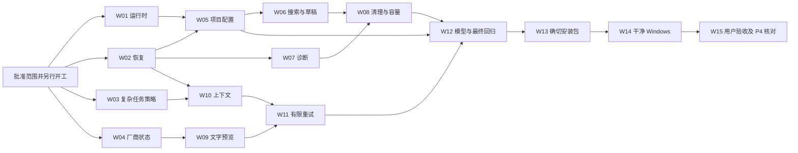

# 剩余工作实现、验收与交付方案

草案 0.2 · 2026-11-28 · 代码基线 `d77a18a3bacff0e631c18bf85370349ac35f73e1`。

**本轮仅编写和检查文档。以下是待批准的执行计划，尚未开始功能开发。确认方案后，仍等待用户另行指定开工时间和工作包。** [评审入口](REMAINING_WORK_REVIEW.md) · [核心架构](REMAINING_WORK_ARCHITECTURE.md) · [扩展设计](REMAINING_WORK_EXTENSIONS.md)。

## 1. 阶段、门槛和依赖

本文件的 G0–G4 是剩余工作的组织方式，不替换原 P0–P4。原 P4 只有满足原适用退出条件才能完成；新增 G 编号不会使既有失败消失。

| 阶段 | 范围 | 进入条件 | 退出结果 |
| --- | --- | --- | --- |
| G0 设计评审 | 设计文档、双窗口协作、34 项映射、N01–N10 | 当前用户已请求 | 形成可评审草案；批准与开工分别记录 |
| G1 稳定性收口 | W01–W04 | 用户明确开始及范围；重新核对仓库基线 | 本地运行、恢复、状态与限额路径通过对应检查；复杂模型能力仍待 W12，不能据此宣布 P4 完成 |
| G2 产品补齐 | W05–W11，W00/W08 的持续整理 | 相应 G1 基础可靠；涉及体验决定已记录 | 设置、搜索、草稿、诊断、数据管理与任务增强按包通过；不扩大 D05 |
| G3 最终交付验收 | W12–W15 | 纳入本次版本的 G1/G2 包通过；模型预算/验收标准明确 | 冻结候选的模型、安装、干净 Windows 和用户验收完整，形成 P4 门槛报告 |
| G4 逐项扩展 | X25–X34 各子包 | 对应范围单独批准；必要基础通过 | 每个新增能力有自己的支持矩阵，不继承首版结论 |

W00 文档与证据贯穿各阶段。G2 中低耦合小包可以并行准备，但修改任务调度、存储、网关等共享代码必须协调串行集成。提前准备 VM 验收脚本不等于提前执行 VM 验收；最终结果必须针对冻结候选。

开工后，开发窗口完成工作包、自检和候选提交，验收窗口在独立检出中验证并反馈。下游依赖以独立验收结果为依据，开发窗口继续处理依赖就绪的事项。通过后按仓库约定整合并同步。交接单、反馈模板、费用入口和中断恢复见[双窗口方案](DUAL_WINDOW_DELIVERY.md)。



图表示主要依赖，不意味着每个包都要等待所有前置文件才能开始设计。任务冻结后代码或模型配置变化，按影响重新跑下游检查；新产物哈希必须重做对应成品验收。

## 2. 工作量口径

采用相对工程量，避免未知根因尚未收敛就给出完成日期：S 为单一模块小改，M 为跨两三个模块的完整交互，L 为跨执行/持久化/故障恢复的大包，探索表示需先验证可行性再估量。量级包括实现与必要检查，不含 API 预算确认、用户验收、镜像下载/登记等等待。

这些是工作拆分尺度，不是人日承诺。评审后可根据实际开发节奏给已批准工作包排期；运行时根因、压缩接口和新平台隔离未知时，先限时调查并交付结论，再决定后续投入。一次把 34 项全部开发并充分验收不适合作为单日承诺。

## 3. G1：运行和任务稳定性

### W01 默认目录与引擎退出（B01、B04；F01/F07/F10；探索→L）

**改动位置**：现有 runtime 定位、session、owned-engine、发布程序验收；按需提取 runtime diagnostics。保留固定版本、原生路径检查、命令契约和 Job 管理。

实施步骤：

1. 固定可复现候选和合成样本，记录首次失败，建立 A3 的配置位置/启动链/阶段对照矩阵。
2. 在启动、子进程建立、stdio 收尾和退出等待边界加入允许字段诊断，找到最小失败条件。
3. 只修复被证据支持的根因；若涉及引擎升级或更换运行方式，先列兼容与权限影响形成决定。
4. 在同一新候选分别执行工作盘与默认 AppData 的读取、npm 测试、修改、审阅、应用、重启和停止。

退出证据：两种配置完整路径通过；超时能结束所属进程并保留真实状态；未降低时限或隔离。间歇退出问题建议在确认复现条件后至少做 10 次相同条件重复检查，并报告次数和观察窗口；未复现只能叫该窗口未观察到，不能宣称彻底消除。无法确定根因时交付复现和限制，B01/B04 保持未完成。

### W02 生命周期、旧任务核对与早期恢复（B02、B03；F07/F08/F09；L）

**改动位置**：tasks/session、私有存储、现有锁/放弃路径、聊天状态组件。依赖现有受控进程能力；W01 的诊断可共用。

实施步骤：定义日志版本和任务身份 → 在副作用前后落盘 → 新启动恢复只读对账 → UI 分开展示终态、进程、审阅和费用 → 旧记录兼容读取。先写模拟/故障样本，真实旧任务最后只读核对，不能用旧数据调试破坏性迁移。

退出证据：关键落盘点前后崩溃均有明确结果；无历史不被假定未执行；PID 复用不误杀；原项目未决应用不解锁为可写；无自动模型请求或命令重放；只有满足既有条件才释放精确锁。对历史缺失证据无法恢复的样本，交付可解释保留状态而不是伪造成功。迁移前后 Key、预算与原项目保持不变。

### W03 复杂源码阅读与资源规划（B05；F03/F04/F06/F09；M）

**改动位置**：任务提示构造、有界文件索引、task-limits、独立答案判据。依赖现有限额，不需先加入压缩。

实施步骤：整理现有失败轨迹中的重复读取和缺失证据 → 检查已有总结/验证机会修正 → 加入精确剩余量和定位优先策略 → 用真实本地引擎配模拟模型验证极限路径 → 为 W12 固定真实源码初态和答案判据。

退出证据分两层：策略与工具边界可在 G1 通过；B05 完整通过必须由 W12 的受控真实复杂源码任务证明。保留原 8 请求/12 工具等限制、首次失败和独立验收器。新试验不得复制历史一次性授权；额度不足时报告待验证，不绕过预算。

### W04 Astra 异常与 UI 竞态（B07；F02/F03/F08；M）

**改动位置**：index IPC、连接设置、事件契约、renderer 请求状态、实际 app-server 联测。依赖 A2 的操作身份和修订规则。

实施步骤：固定 provider/chat/operation 和 taskGeneration 身份 → 为页面订阅分配 subscriptionEpoch → 重订阅获取 snapshot/cursor 并过滤旧投递 → 正确展示拒绝与收尾 → 验证恢复身份一致。连接检查以自身 operationId 关联结果；保留旧聊天固定厂商和独立价格/Key/预算。

退出证据：拒绝事件确实经过实际引擎后终止，工具零执行；连接过程中切页/切厂商/删除设置不会写错结果；旧成功/失败消息不会覆盖新状态；取消后不重新变忙。故障场景先用模拟协议加真实引擎精确触发，并与真实 API 接入证据分栏，不声称可控模拟拒绝就是服务端真实拒绝验证。

## 4. G2：首次使用和日常体验

### W05 项目诊断、发现与配置（B11–B13；F01/F06/F07；L）

**改动位置**：projects、shared contracts、任务配置、settings sidecar、项目设置 UI；依赖 W01/W02。

实施步骤：

1. 静态发现项目要求、脚本及文档建议，保存来源与冲突；先不执行任何发现的脚本。
2. 建立项目设置 schema 和 CAS 保存，旧 testCommand 迁移与中断恢复。
3. 持久保存 TaskConfigSnapshot 的完整规范化内容和有效权限，把 cwd、验证命令与约束映射到副本；恢复禁止借用最新设置。
4. 先验证 writablePaths 在文件工具和 shell/子进程的真实权限可行性，再开放 UI；测试生成物有独立受限写区。
5. 完成首次选择项目→诊断→选择建议→保存→只读/修改任务的流程。

首轮实际探针限定为受控运行时的版本/可执行性与受支持项目的依赖完整性检查；具体检查项须先列允许清单，再验证无安装脚本或服务副作用。静态声明与实际探针结果分栏。外部服务不主动连接，无法证明的依赖显示未验证；W05 只能宣称清单中实测支持的诊断，不称全语言/全依赖诊断完成。

退出证据：恶意 README 不执行；缺依赖显示未知/缺失；越界、链接、新文件父目录与 shell 写禁区实际拒绝；运行中设置变化不改变当前任务；正常 JS/TS 验证命令兼容。若细粒度路径不可实施，提交具体受限方案给 N01/N08 选择，B13 不标全量完成。

### W06 聊天搜索、项目搜索与草稿（B20–B22；F03/F04/F08；M，可拆三小包）

**改动位置**：chat/project search services、draft service、IPC、左侧搜索、右侧文件面板和 composer。依赖 W05 的项目身份以及 W02 的消息接收状态。

实施顺序：草稿持久化与发送修订 → 聊天分片正文索引 → 项目文件/字面量搜索 → 消息和文件定位。索引为派生数据，查询有界且可取消；不在主进程同步载入全部历史。

退出证据：重启可恢复已确认草稿；发送后继续输入不会被清空；崩溃不会自动重发；删除聊天同步失效草稿/索引；大记录查询不阻塞停止按钮；结果文件变动提示刷新；敏感/排除路径不出结果。工具搜索已有，B21 验收针对用户界面入口。

### W07 脱敏诊断预览和导出（B17；F09；M）

**改动位置**：diagnostics、IPC、设置面板；依赖 W02 的允许字段事件。

实施顺序：字段允许清单 → 数据分类和匿名 ID → 冻结 previewId/hash → 主进程保存对话框 → 有效期和导出一致性检查。故障报告默认只含必要元数据，无自动上传。

退出证据：合成 Key、路径、源码和私有推理哨兵均不出现在导出；预览和文件哈希一致；取消不落文件；预览过期或目标路径替换拒绝；预算选择只导出汇总且不修改账本。

### W08 批量删除、保留和开发清理（B18、B19、B24；F08/F09；L）

**改动位置**：已有 deletion、inventory/retention、私有文件保护、数据管理 UI；依赖 W02、W06、W07。

实施顺序：盘点与保护原因 → 只读清理预览 → 逐项计划及持久执行 → 部分失败/重启继续 → 产品配额和空间预检。保持单聊天删除行为，不新增递归清空捷径。

退出证据：活动/未决/待审阅数据不删除；计划后对象变化即跳过；中断可解释恢复；新 sidecar 纳入归属清单，删除时在途草稿保存/索引作业不会使内容复活；不误删用户原项目、Key、两种账本；空间不足拒绝新任务；“全部删除”存在保留项时不显示全部成功。自动删聊天默认关闭，配额由 N07 决定。

B24 作为单独开发卫生子项：先盘点精确路径、归属、进程和需留证据，再按现有清理约定操作。此前自动审批拒绝的具体清理保持原状态；若再次无法获准，记录原因和占用，不通过换工具绕过。该项不影响设计文档本轮交付，也不把受阻目录假称已清理。

### W09 模型文字增量预览（B14；F03/F09；M）

**改动位置**：模型请求 parser、session 展示事件、IPC 和聊天组件；依赖 W04。

实施顺序：复用协议 parser 建立只读展示支路 → 跨块过滤/限长/背压 → UI 预览身份与最终替换 → 独立开关与回退。引擎仍只收到完整校验通过的响应。

退出证据：早期文字出现而工具尚未执行；后续非法工具导致整段响应拒绝且执行数零；跨块秘密、重复/迟到事件、停止、断流、拒绝和最终去重全部覆盖。两厂商实际协议模拟分别验收；真实文字和工具流程在 W12 按预算确认。

### W10 上下文预检、压缩与续接（B15；F03/F08/F09；探索→L）

**改动位置**：任务预算视图、引擎协议适配、context checkpoint、UI；依赖 W02/W03。

实施步骤：先统一持久化 TaskBudgetContext，保证内部续接不新建试验/计数/截止时间，再交付实际请求大小预检和提示；另做固定引擎压缩能力小探针，分别记录两个模型；能力成立才实现受控 checkpoint 和持久化提交；否则实现 N05 明确接受的新聊天交接。

退出证据：96 KiB 边界不会静默裁剪；压缩计入原请求/工具/时间和费用上限；崩溃/取消不损坏旧历史；工具结果关联和必要推理连续性保持；恢复不重放；新聊天交接明确标识非无损恢复。探针可能需要真实调用，先有对应额度。无法证明能力时保留未完成，不以 UI 按钮通过验收。

### W11 有条件的有限重试（B16；F07/F09；M）

**改动位置**：请求 attempt、预算、错误分类、任务停止与错误 UI；依赖 W02/W09/W10，避免叠加多个恢复入口。

实施顺序：失败分类与幂等身份 → 在途/未知费用核对 → 默认关闭的策略 → 有证据安全的最多一次附加尝试 → 展示实际尝试和费用。工具副作用不自动重放。

退出证据：断线后的未知请求不自动重发；HTTP 429/5xx 不直接视为免费；重试消耗原限额、原剩余时间并再次预留；退避时停止立即有效；重复事件不重复结算；费用全额计入不等于授予工具重放。N06 若只选择手动继续，则准确标记自动重试仍未启用。

## 5. G3：模型、安装与用户验收

### W12 双厂商能力与最终回归（B05、B06，复核 B07/B14–B16；F02–F09；M + 外部预算）

**前提**：本次版本纳入的 G1/G2 工作包检查通过；N03/N04 已明确；候选源码、模型配置、价格版本、样本、验收器和规定初态冻结。

| 验收组 | 次数与内容 | 通过口径 |
| --- | --- | --- |
| Astra 基础能力 | 阅读、bug 修复、小功能，各 3 个独立运行 | 每次按初态开始；答案/独立断言通过；原测试不退化，无人工补丁替代模型 |
| DeepSeek 回归 | 按网关、任务、恢复改动影响选择；若相关共享链路改变则覆盖三类各 3 次 | 保留旧证据，新增结果明确绑定当前配置；不得拿 Flash 结论替代 Pro |
| 复杂源码 | 事先固定真实阅读目标、关键答案和工具限额 | 关键答案有来源且正确；未覆盖项明确；不能只给部分总结就标成功 |
| 共享异常 | 停止、拒绝、预算不足、断流、未知用量、恢复身份、冲突 | 精确故障注入配实际引擎/系统；与真实模型样本分栏 |

准备预算方案时给出按固定输入/最大输出的最坏预留、试验总限额、请求上限与停止条件，不能只按历史平均费用估算可承受。DeepSeek 原累计剩余额与未知占用保持；Astra 新矩阵不能借用 11 月 25 日一次性 5 美元授权。额度不够就缩小已明确批准的试验或等待决定，不改阈值来过关。

首次失败、修复后的独立复验和人工介入分别记录。建议标准为每次独立规定验收均通过；若用户希望采用其他成功率、速度或成本标准，必须在运行前确定，并保留原试验结果。未实际执行的格子标待验证。

### W13 最新确切候选安装/卸载（B08；F10；M）

**前提**：W12 通过适用检查，冻结源码提交、锁文件、运行时清单和安装包 SHA-256。若安装前需修包，重新确认影响范围。

流程：在专用测试配置确认没有被覆盖的个人安装 → 安装 → 首次启动/运行时定位 → 模拟完整任务/停止/重启 → 更新兼容的既有配置样本 → 卸载 → 核对声明应保留和应删除的数据。测试不得借用用户日常 Key 或原项目；真实 API 只在已明确预算的验收中调用。

退出证据：最新哈希安装与卸载均成功，保留语义准确，应用/运行时文件与清单一致，无开发路径兜底；无个人状态误删除。历史旧安装包通过不能沿用。当前未签名候选的限制明确，签名另属 X34。

### W14 干净 Windows 验收（B09；F01/F07/F10；M + 环境等待）

**前提**：W13；此前用户已选择的专用 VM 方案按实施时环境重新核对，当前无已备镜像/VM。下载、登录或许可相关步骤按实际要求处理，不修改用户主机安全配置作为绕行。

流程：核对官方镜像来源/版本/哈希 → 独立 VM 与基础快照 → 无开发依赖安装 → 默认 AppData 运行 → 只读/修改/应用/停止/重启检查 → 使用受控临时测试配置和适用预算完成真实小任务并核对收尾 → 删除测试凭据、保存脱敏证据 → 卸载并检查数据保留。

退出证据：默认路径真实闭环通过；不存在隐式全局运行时帮助；中文/空格路径、标准用户、缺依赖、低磁盘等适用场景按支持矩阵记录；两家模型的未覆盖格子明确。没有 VM 或预算时保持未验收，不用开发机模拟代替。

### W15 用户任务、界面和 P4 门槛（B10；F01–F10；M + 用户时间）

**前提**：W12–W14；用户选择支持范围内的实际任务，明确数据发送和相应额度；界面仍按既有截图规范。

流程：首次使用→环境与设置→阅读→修复/小功能→审阅决定→停止及重启→历史查找。记录成功与未完成、模型请求/工具数、总时间、费用/未知预留、用户介入次数，以及用户是否理解待应用/已应用/验证失败/待核对。

退出证据：用户对功能和布局反馈被处理或明确列为限制；F01–F10 各适用项都有当前证据；无未处理越权、已有修改丢失或取消后继续写入。形成 P4_GATE_REVIEW（建议新证据文档名）列通过、失败、未覆盖和后置范围。只有全部适用退出条件满足才标 P4 完成。

## 6. W00 文档、证据与版本保存（B23；贯穿全部阶段；S）

本轮已授权的是设计文档产出：补充评审入口、架构、实施、扩展文档，并在现有入口和 PROGRESS 标明等待用户审阅及另行开工。此工作不意味着 B23 所有历史措辞已全面校正，更不意味着 B01–B34 功能已完成。

后续每包检查后更新：功能编号、当前支持范围、真实/模拟类别、首次失败、未决问题、下一步；校正开发方案中 D01 已落地、日常预算和双厂商等陈旧措辞，同时保留带日期的历史验证结论。README 的使用方式与实际候选保持一致。

提交前只暂存明确文件清单，检查密钥/原始日志/产物未入库；依原授权正常提交推送 `Canghaior/lcodex` 并核对远程完整 SHA。推送失败保留本地提交和待同步记录，不强推。这是本仓库开发流程，不是向产品新增自动 Git 功能。

## 7. 通用测试、迁移和回退策略

| 层级 | 检查内容 | 不得冒充的结论 |
| --- | --- | --- |
| 文档/静态 | 编号覆盖、链接、状态、diff；代码改动才做类型和构建 | 文档设计不证明功能实现 |
| 单元/存储 | 解析、边界、CAS、损坏、迁移、删除与预算不变量 | 内存 mock 不证明 Windows 隔离 |
| 实际引擎 + 模拟模型 | 真实文件/进程、串行工具、拒绝、停止、竞态 | 不证明真实模型能力 |
| 成品程序 + 模拟模型 | 捆绑运行时、路径、UI、恢复与应用 | 不证明服务端协议或模型质量 |
| 真实 API | 当前厂商/模型/配置、费用与任务能力 | 一次连接不证明三类任务或所有项目 |
| 安装/干净环境/UAT | 确切包、独立环境、用户流程 | 开发机结果不能代替 |

每包先做最小相关检查，通过后按影响执行共享回归；涉及网关、预算、路径或恢复时必须扩大到相应系统边界。沿用现有 `npm run check`、相关测试、必要构建与成品脚本；具体子命令在实施时核对 package.json，不为文档伪造不存在的脚本。低影响文档改动不跑付费或全套功能测试。

数据迁移必须有旧格式夹具、逐落盘点故障注入、空间不足、未知格式和身份冲突检查。回退功能开关可禁用预览/自动重试等新能力，但不能删掉未决日志或强行降级已经升级的数据；不可逆迁移先做兼容方案再执行。回退应用程序版本与撤销用户项目变更是两件事。

每个包交付最少包含：代码/文档差异、对应 B/F 编号、必要行为证据、首次失败、已知限制、迁移/回退说明、精确版本和下一步。不得通过删断言、改初态、放宽限额或修改独立验收器消除失败。

## 8. 扩展工作如何接入

G4 不采用一个总开关。批准某个 X 子包后，先固定目标平台/项目/工具及成本，再补该包实施设计与验证矩阵。完整分期见[扩展设计](REMAINING_WORK_EXTENSIONS.md)。

| 扩展 | 最早依赖与需要额外核对的边界 |
| --- | --- |
| X25 撤回 | W02/W08 + 受控应用；D02 变更、恢复内容引用和冲突 |
| X26 大项目/多语言 | W05/W06/W10；D05 变更、完整复制与依赖真实性 |
| X27 跨平台 | G3 Windows 基线；平台等价隔离、密钥与停止能力 |
| X28 队列/并行/多 Agent | W02/W08；预算并发、单项目写锁、子任务取消与补丁归属 |
| X29 工具/插件 | 统一能力边界、身份与撤权；外部数据和执行风险 |
| X30 自动化 | X29 相关能力控制；外部副作用核对和人工接管 |
| X31 新厂商 | W04/W09–W12；新协议、费用、恢复身份和独立真实验收 |
| X32 同步 | W02/W08；加密、冲突、删除、设备权限和持续服务成本 |
| X33 Git/IDE | W05 与应用基线；索引保护、远程动作、终端/LSP 权限 |
| X34 发布/更新 | G3 + 迁移兼容；许可证、签名、损坏包、低磁盘与更新中断 |

某个扩展调查失败时，应交付明确不可行点和替代选项，而不是降低已有保护。新增支持只对被验证矩阵成立，不写成“支持任意语言/平台/插件”。

## 9. 开工前记录模板

此模板供用户确定时间后填写，不是本轮要求用户立即批准：

```text
方案版本：
批准的工作包：
本次不纳入的范围：
需要调整的 N 决策：
验收初态与成功/时间/费用标准：
新真实试验预算（分别写厂商、币种、试验、额度和请求数）：
开工指令或约定时间：
实际开始时核对的源码与远程 SHA：
```

截至本草案，只有设计文档工作在进行。未来开发时间由用户另行决定，既不自动启动开发，也不设置后台定时任务。
